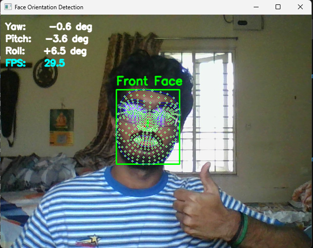

# FaceView — Multi-Angle Face Orientation Detection

FaceView is a real-time computer-vision project that uses a webcam to estimate whether a face is oriented approximately forward, left, or right.

The project provides two approaches: a lightweight 2D baseline heuristic and an updated 3D head-pose estimation pipeline using MediaPipe Face Mesh and OpenCV.

## Demo



A live demonstration recording is available in [`demo/faceview-demo.mp4`](demo/faceview-demo.mp4).

## Features

- Real-time webcam video processing
- 468-point facial landmark detection via MediaPipe Face Mesh
- Face orientation classification: `Front Face`, `Left Side Face`, and `Right Side Face`
- 3D pose estimation delivering approximate yaw, pitch, and roll angles in degrees
- Visual HUD with real-time landmark mesh, projected 3D coordinate axes, orientation labels, and FPS display
- Clean keyboard interaction (press `q` to exit)

## Technologies used

- Python 3.12
- OpenCV (`cv2`)
- MediaPipe (`mediapipe`)
- NumPy (`numpy`)

## Project structure

```text
faceview-mediapipe/
├── assets/
│   └── faceview-demo.png
├── demo/
│   └── faceview-demo.mp4
├── main_updated.py
├── main_baseline.py
├── README.md
├── requirements.txt
├── .gitignore
└── FaceView_Project_Documentation.pdf
```

- `main_updated.py` — Updated 3D head-pose estimation implementation.
- `main_baseline.py` — Baseline 2D facial-symmetry heuristic.
- `FaceView_Project_Documentation.pdf` — Comprehensive project documentation and learning guide.
- `assets/faceview-demo.png` — Real-time demonstration screenshot showing pose estimation and HUD overlay.
- `demo/faceview-demo.mp4` — Recorded demonstration video showing live webcam orientation tracking.
- `requirements.txt` — Project dependencies (`opencv-python`, `mediapipe`, `numpy`).
- `.gitignore` — Specifies files and folders excluded from version control (e.g., virtual environments, caches).

## Installation and setup

Clone the repository and set up a virtual environment (Windows PowerShell):

```powershell
# Clone the repository
git clone https://github.com/The-shriram14/FaceView.git
cd FaceView

# Create and activate a virtual environment
py -3.12 -m venv .venv
.\.venv\Scripts\Activate.ps1

# Upgrade pip and install dependencies
python -m pip install --upgrade pip
python -m pip install -r requirements.txt
```

## How to run both versions

Run only one script at a time, as both access the webcam.

### Running the updated pose-estimation version

```powershell
.\.venv\Scripts\python.exe -u main_updated.py
```

### Running the baseline version

```powershell
.\.venv\Scripts\python.exe main_baseline.py
```

Press `q` inside the OpenCV display window at any time to exit cleanly.

## How the project works

The updated implementation follows a 7-step computer-vision pipeline:

1. **Frame Acquisition:** Capture raw video frames from the default webcam using OpenCV.
2. **Color Conversion:** Convert frames from BGR to RGB format required by MediaPipe.
3. **Landmark Detection:** Detect facial landmarks using MediaPipe Face Mesh.
4. **2D-to-3D Landmark Matching:** Extract key 2D facial feature coordinates (nose tip, chin, left/right eye corners, left/right mouth corners) and pair them with corresponding points from a generic 3D reference head model.
5. **Perspective-n-Point Pose Estimation:** Solve for the 3D rotation and translation vectors using OpenCV's `solvePnP`.
6. **Euler Angle Extraction:** Convert the rotation vector into a rotation matrix and derive estimated yaw, pitch, and roll angles.
7. **Orientation Classification and Rendering:** Classify the face as `Front Face`, `Left Side Face`, or `Right Side Face` based on the estimated yaw angle against a threshold, and render the annotated landmarks, 3D pose axes, angle readouts, and FPS onto the output frame.

## Baseline versus updated implementation

| Aspect | Baseline (`main_baseline.py`) | Updated (`main_updated.py`) |
|---|---|---|
| **Approach** | 2D geometric symmetry heuristic | 3D Perspective-n-Point (`solvePnP`) pose estimation |
| **Landmark Usage** | Compares horizontal eye-to-nose Euclidean distances | Maps 2D landmarks to a canonical 3D reference head model |
| **Output Categories** | Distinguishes `Front Face` vs. `Side Face` | Distinguishes `Front Face`, `Left Side Face`, and `Right Side Face` |
| **Angle Estimation** | None (no angle measurements) | Estimates yaw, pitch, and roll in degrees |
| **Visual HUD** | Orientation text overlay | Real-time landmark mesh, 3D coordinate axes, numerical angles, and FPS |
| **Distinction** | Cannot differentiate left from right side orientation | Classifies left versus right using the sign of estimated yaw. |

## Limitations

- **Generic 3D Head Model:** The 3D reference points represent a generic canonical face rather than an individually calibrated anatomical model.
- **Approximate Camera Matrix:** Camera intrinsic parameters (focal length and principal point) are approximated from frame dimensions rather than formal checkerboard camera calibration.
- **Angle Validation Scope:** Yaw estimates drive orientation classification effectively, but pitch and roll angles have not been comprehensively validated for ground-truth measurement accuracy.
- **Heuristic Threshold:** Orientation labels are derived from a fixed yaw threshold rule rather than a machine-learned orientation classifier.
- **Environmental Sensitivities:** Extreme lighting variations, severe face occlusions, or extreme tilt angles can affect facial landmark stability.

## Validation performed

Controlled manual webcam tests were conducted to verify functional correctness:
- **Front-Facing Pose:** Confirmed correct `Front Face` classification when looking straight ahead.
- **Left Head Turn:** Confirmed correct `Left Side Face` classification with expected yaw angle direction.
- **Right Head Turn:** Confirmed correct `Right Side Face` classification with expected yaw angle direction.
- **Eyes-Only Movement Check:** Confirmed that looking sideways with eyes while keeping the head forward maintained `Front Face`, verifying response to head orientation rather than gaze.
- **Application Exit:** Confirmed prompt and clean resource cleanup upon pressing `q`.

*Note: These tests represent functional verification of expected behavior, not an exhaustive failure-mode benchmark or formal measurement accuracy study.*

## Project Documentation

Read the [FaceView Project Documentation](FaceView_Project_Documentation.pdf) for the system workflow, baseline-versus-updated comparison, implementation concepts, limitations, and interview preparation notes.

## Future improvements

- Implement formal camera calibration using a checkerboard target to obtain exact intrinsic parameters.
- Benchmark angle estimates against ground-truth head-pose datasets (such as BIWI or AFLW2000-3D).
- Expand orientation handling to include vertical tilt (pitch classification for looking up/down).
- Introduce temporal smoothing (e.g., Kalman filter or moving average) to reduce landmark jitter in low-light environments.
- Add robust automated error-handling routines for camera disconnects and edge-case landmark loss.
